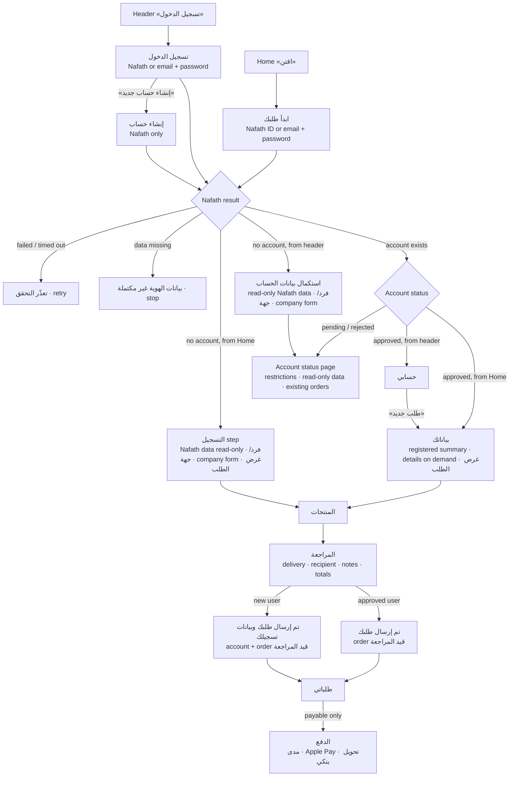
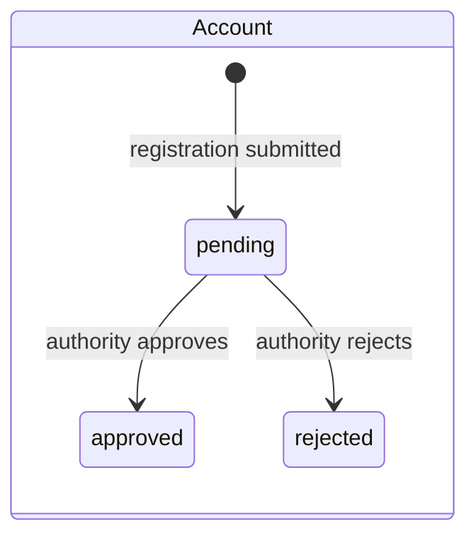
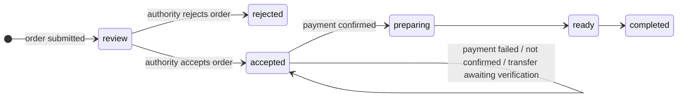

# Zamzam portal: journeys, states and open rules

This document covers the two entry points, the account and order state models, the scenario
checklist (automated in `e2e/scenarios.mjs`), and the business rules that still need confirmation.

## 1. User-flow map

Rules applied on every route:

- `#order` and every portal action go through one guard (`PortalStore.guardView`). Signed-out users
  see identification; pending and rejected accounts see only the status page, «طلباتي» read-only and
  password settings; approved accounts see everything.
- Nafath data (name, ID, phone, email) is read-only everywhere and never asked for again.
- Back buttons move between steps without losing entered data (it is kept in session storage).

## 2. Status model

Account and order are separate decisions.

| Account | Order | What the customer sees | Pay button |
| --- | --- | --- | --- |
| pending | review | حسابك وطلبك قيد المراجعة | no |
| pending | accepted | تم قبول الطلب — بانتظار اعتماد حسابك | no |
| approved | review | طلبك قيد المراجعة | no |
| approved | accepted, unpaid | تمت الموافقة — الدفع مطلوب (or transfer details) | yes |
| approved | accepted, payment failed | لم تكتمل عملية الدفع · إعادة المحاولة | yes |
| approved | accepted, not confirmed | لم يتأكد الدفع بعد · تحديث حالة الدفع | no (refresh only) |
| approved | accepted, transfer proof sent | بانتظار التحقق من التحويل | no |
| rejected | any | لا يمكن متابعة الطلب | no |
| any | rejected | تعذّر قبول الطلب + reason | no |

Payable = account `approved` AND order `accepted` AND payment `none` or `failed` (`rules.isPayable`).
New orders = account `approved` only (`rules.canCreateOrder`).

## 3. Scenario checklist

All 18 run automatically: `node e2e/scenarios.mjs` (demo build). Demo IDs are listed in
`src/portal/fixtures.ts`.

| # | Scenario | Start | Actions | Expected | Final state |
| --- | --- | --- | --- | --- | --- |
| 1 | Approved user orders from Home | Signed out | «اقتن» → Nafath `1012345678` → expand details → purpose → products → review → send | Registered summary, Nafath fields locked; purpose required | Order قيد المراجعة; no pay button |
| 2 | New user, individual | Signed out | «اقتن» → Nafath new ID → فرد → purpose → products → review → send | «أنت غير مسجّل بعد»; read-only identity; type required | Account pending + order in review, shown separately |
| 3 | New user, company | Signed out | جهة → غير ربحي → company lookup (found) → rep ID type → purpose → send | Registry fields locked; rep fields prefilled from Nafath, editable; 50% discount | Account pending + order in review |
| 4 | New user submits while pending | After #2 | Open the order | «حسابك وطلبك قيد المراجعة» | No pay action |
| 5 | Pending user tries another order | Pending with order | «اقتن», `#order` | Redirected to status page with reason | No order created |
| 6 | Login by Nafath | Signed out | Header → Nafath `1023456789` | Profile with «طلب جديد» | Can start orders |
| 7 | Login by email | Signed out | Email tab → `a.alharbi@example.com` / `123456` | Profile | Signed in |
| 8 | Register from header | Signed out | «إنشاء حساب جديد» (Nafath only, notice shown first) → type → send | Type required | Account pending, status page |
| 9 | Pending user opens portal | Pending, no orders | Header → «طلباتي» | Read-only list with restriction; no «طلب جديد» | Unchanged |
| 10 | Account approved, order pending | Pending with order | Demo: approve account | Profile; order still قيد المراجعة | No pay button |
| 11 | Order accepted, account pending | Pending with order | Demo: accept order | «تم قبول الطلب — بانتظار اعتماد حسابك» | No pay button |
| 12 | Pay before acceptance | Approved | Open an order under review | Next-step panel explains review | No pay button |
| 13 | Nafath missing data / failure | Signed out | `1067890123`; `1078901234` | Stop with explanation; retry for failure | Nothing saved |
| 14 | Invalid ID / credentials | Signed out | ID `123`; wrong password | Field error; generic credential error with recovery hint | Signed out |
| 15 | Company with missing fields | New user | جهة → continue; lookup not found → continue | Each missing field flagged | Stays on step |
| 16 | Back navigation | New user | Purpose → products (+1) → back → forward | Purpose and quantities kept | — |
| 17 | Rejections | Rejected account; rejected order | Sign in; open rejected order | Reason + «تواصل معنا»; order reason + «تقديم طلب جديد» | No ordering for rejected account |
| 18 | Payment failure / unconfirmed | Approved, accepted order | Demo outcome فشل → pay; لم تتأكد → retry; نجاح → refresh | Failed keeps order unpaid; unconfirmed blocks a second charge | Paid → قيد التجهيز |

## 4. Decisions that changed earlier behaviour

- Approved users no longer pay at submission. Every order is reviewed first, per the brief
  («approved user must still follow the order-review and payment process»).
- Registration is Nafath only. Email + password remains for signing in to accounts that set a password.
- New users who register from the header cannot create orders until approved. Users who start from
  Home submit their first order with the registration and cannot create another until approved.
- «نوع الجهة» moved from each order to the company account (it drives the non-profit discount).
- The 8-second automatic approval was replaced by explicit back-office controls in the demo panel.

## 5. Unresolved business rules

1. **Order purpose for individuals.** «غرض الطلب» is now required on every order. The earlier design
   asked for it only from companies. Confirm.
2. **Entity type ownership.** Is «نوع الجهة» fixed per company account (current build) or chosen per
   order? It changes who can claim the non-profit discount.
3. **Review order.** Can the authority accept an order before approving the account? The build
   supports both, and payment waits for both decisions.
4. **Missing Nafath data.** What is the official recovery path when Nafath returns no phone or email?
   The build stops and suggests trying later or contacting support.
5. **Account rejection policy.** Appeal, resubmission with corrected data, and timelines are not
   defined. The build shows the reason and a contact link only.
6. **Password recovery when signed out.** No reset flow exists. The build tells users to sign in
   with Nafath and set a password from «حسابي».
7. **Profile changes after approval.** Which fields can change, and does the account stay approved
   while a change is reviewed? The build allows company-representative changes and keeps the
   account approved.
8. **Company representative default.** The build assumes the registrant is the representative and
   prefills from Nafath (editable). Confirm, and whether a representative needs a delegation letter.
9. **Commercial-register lookup.** Search by name (as designed) or by CR number? Which registry
   fields are authoritative and locked?
10. **Unconfirmed payments.** Provider status-query endpoint, retry window and timeout for the
    «لم يتأكد الدفع بعد» state.
11. **Payment deadline.** The orders screen shows «مستحق قبل» seven days after the order date, as in
    the design. Is there a real deadline, and what happens after it?
12. **Notification channels.** How account and order decisions reach the customer (SMS, email, in-app).
13. **Default payment method.** The build defaults companies to bank transfer and individuals to مدى,
    as in the design.
14. **Delivery map.** The design's map picker was unreachable; the build keeps automatic location
    plus manual national address. Confirm whether the map picker is needed.
